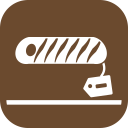
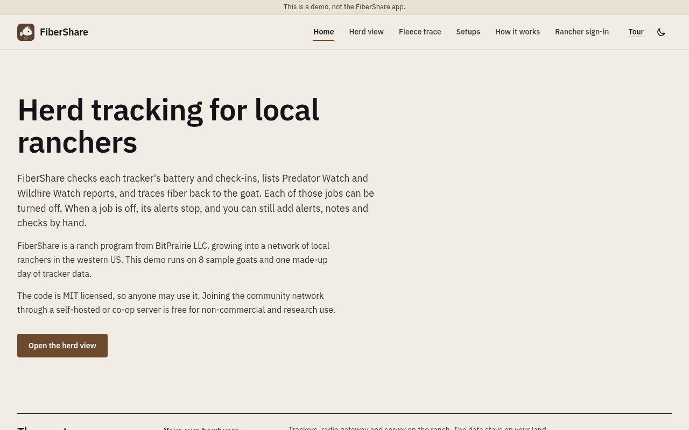
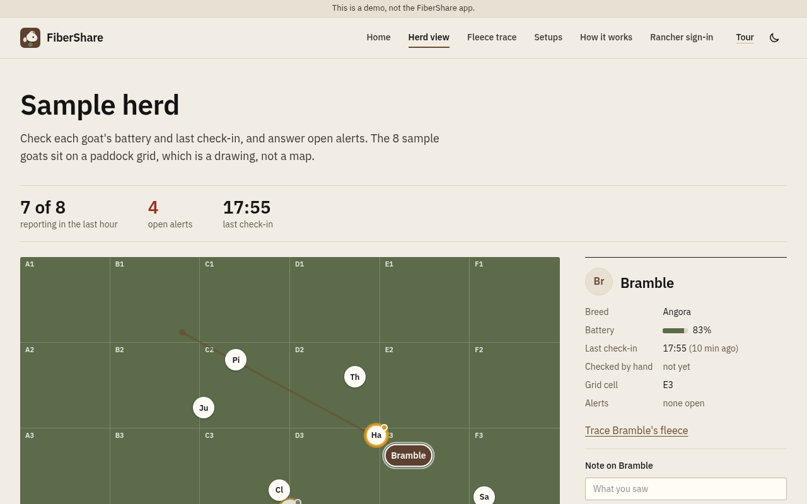
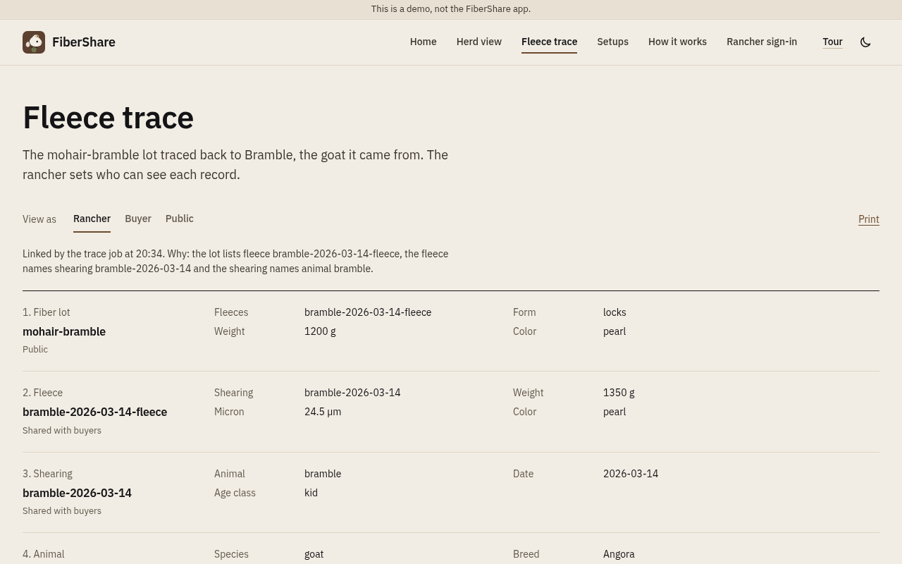

<picture>
  <source media="(prefers-color-scheme: dark)" srcset="public/brand/logo-dark.svg">
  <source media="(prefers-color-scheme: light)" srcset="public/brand/logo-light.svg">
  
</picture>

# FiberShare (open source)

This repository is a browser demo of herd tracking and fiber trace. It has eight sample goats on a paddock drawing, one made-up day of tracker data, and a fleece lot you can trace back to the goat. It runs on sample data, works offline, and is meant for ranchers, hardware makers, and developers who want to see the idea before wiring real collars.

This repository is **not** the FiberShare app at [fibershare.app](https://fibershare.app). Ranch support pays for animals and pasture. Support is not ownership or an investment return. BitPrairie LLC builds FiberShare.



## Features (what is shipped)

- **Herd view.** Eight sample goats on a paddock drawing, not a map. Run the sample day to move through one made-up day. Open alerts, the animal ledger, and a collapsed event log sit on the same page.
- **Alerts.** Low battery, missed check-in, animal not moving, animal outside the paddock, tracker SOS, plus simulated Predator Watch and Wildfire Watch on the sample day. Confirm, dismiss, or add one by hand. Each job can be turned off.
- **Paddock moves.** A short log of sample paddock moves and grazing notes for this sample day.
- **Tracker trail.** Select a goat while you run the sample day to see a short trail of its last few positioned check-ins.
- **Fleece trace.** Trace the `mohair-bramble` lot through fleece and shearing records to Bramble. A rancher, a buyer, or the public can be the viewer. Nothing is for sale.
- **Setups.** Your own hardware, hosted by BitPrairie, or a mix.
- **Rancher sign-in and map.** Public view hides tracker details; a signed-in rancher can see real names and positions. See [docs/rancher-access.md](docs/rancher-access.md).
- **Tour.** Five short steps, started from the herd view. Esc closes it.

| Herd view | Fleece trace |
| --- | --- |
|  |  |

## Docs and schemas

| Link | What it is |
| --- | --- |
| [docs/DIRECTION.md](docs/DIRECTION.md) | Demo vs the FiberShare app |
| [docs/rancher-access.md](docs/rancher-access.md) | Local passphrase and Cloudflare Access |
| [docs/chirpstack.md](docs/chirpstack.md) | Pull live trackers from ChirpStack v4 |
| [docs/hardware.md](docs/hardware.md) | Trackers, cameras, gateways and satellite links, with what each does on a ranch |
| [docs/paddock-cameras.md](docs/paddock-cameras.md) | Live paddock video over Media over QUIC, and how it fits FiberShare |
| [docs/schemas/](docs/schemas/README.md) | Draft animal, shearing, fleece, and fiber-lot JSON Schemas |
| [docs/schemas/examples/](docs/schemas/examples/) | Example records used by the fleece trace |
| [ROADMAP.md](ROADMAP.md) | Shipped vs planned work |
| [CONTRIBUTING.md](CONTRIBUTING.md) | How to help |

When you run the demo, the same guides are also at `/docs`. Each guide has a Markdown copy, and `/llms.txt` is a plain-text map of the demo and those guides.

## Automated jobs

| Job | Rule |
| --- | --- |
| Low battery (below 20%) | Trackers on outside power are skipped |
| Missed check-in (after 2 hours) | No check-in for over 2 hours |
| Animal not moving (after 2 hours) | Still checking in for over 2 hours with little movement |
| Animal outside the paddock | Active paddock bounds are 0-100 on the grid |
| Tracker SOS | The alert names the animal |
| Predator Watch reports | The sample day has one simulated report |
| Wildfire Watch reports | The rancher map adds public fire, smoke and air quality layers |
| Fleece trace, lot back to the goat | Through the fleece and shearing records |
| Refresh live data (every 2 minutes) | Live data only. The pull script runs only when you start it |

Every job is on until you turn it off, on How it works or in the herd view's Alert settings. The setting is saved in the browser. Each automated alert says which rule and reading raised it and when the rules ran, for example "Battery 14%, below the 20% limit, not on outside power." With every job off, a rancher can still answer and add alerts, save notes, mark animals checked and change the battery, quiet, and not-moving limits.

Alerts are an aid, not a guarantee. They can be late, wrong or missing, and turning a job off stops its alerts. Keep checking your animals in person. In an emergency, call 911.

The default thresholds and the rules live in `crates/core`. The pages and the server call that same crate. Each answer is stored with the rule that raised the alert.

The rancher makes every decision. Nothing moves animals, opens gates or contacts anyone without the rancher's OK.

Planned: paddock grazing records. Planned: a usual check-in pattern for each tracker, so unusual quiet stands out. Planned: tighter alert rules from the answers ranchers already give. Planned: share a confirmed Predator Watch report with nearby ranchers. [ROADMAP.md](ROADMAP.md) has the detail.

## Hardware

FiberShare runs on LoRaWAN collar trackers, a LoRaWAN gateway and a network server on the ranch. Paddock cameras that send live pictures over Media over QUIC are being tested. They are not in this demo yet.

Planned:

- A live camera view for a signed-in rancher
- Detections from cameras sent to Predator Watch as reports the rancher confirms or dismisses
- Stills for Wildfire Watch smoke checks
- A satellite link for alerts where there is no cell signal

[docs/hardware.md](docs/hardware.md) lists the devices, what each one does on a ranch, and what is worth testing next. [docs/paddock-cameras.md](docs/paddock-cameras.md) covers the camera work.

## Setups

| Setup | What it means |
| --- | --- |
| Your own hardware | You build or buy the trackers and gateway and run the server yourself. Nothing has to leave the ranch. |
| Hosted by BitPrairie | BitPrairie runs the server and can supply the trackers. |
| A mix | Your gateway and server on the ranch, with hosted alerts from BitPrairie. |

The community network is the main part of the project. Ranchers can share a server they host themselves, or a co-op server. The code is MIT licensed, so anyone may use it. The hosted alerts come from Predator Watch and Wildfire Watch, which run on BitPrairie's realtime intelligence systems.

| Open source | BitPrairie |
| --- | --- |
| This demo | The hosted FiberShare app |
| Record schemas (draft) | Predator Watch and Wildfire Watch |
| Self-hosting docs | Hosted alerts and relay |
| | Hardware kits and support |

## Your data

- Public pages never show where an animal is.
- Tracker positions stay on the server until the rancher signs in.
- In the FiberShare app, positions become cells on a private grid when they arrive. GPS coordinates are not stored.
- Each rancher owns their event history. It is shared only if they opt in.
- Planned: data shared with agencies or researchers is combined or delayed, with no exact locations.

This repository holds no secrets, API keys, mail settings or real collar data. A test checks every committed file for DevEUI-like hex strings and coordinates.

## Quick start

You need Rust 1.85 or newer.

```bash
git clone https://github.com/bitprairie-team/fibershare-oss.git
cd fibershare-oss
cargo run -p fibershare -- serve
```

Then open http://127.0.0.1:4174.

| Command | What it does |
| --- | --- |
| `cargo run -p fibershare -- serve` | Serves the pages and the API at http://127.0.0.1:4174 |
| `cargo run -p fibershare -- build` | Writes static pages into `dist/` |
| `cargo test --workspace --exclude fibershare-client --exclude fibershare-worker` | Runs the tests |
| `cargo fmt --all -- --check` and `cargo clippy -p fibershare-core -p fibershare-html -p fibershare --all-targets -- -D warnings` | Format and lint |
| `fibershare pull` | Reads your trackers from your network server into `.local/live.json`. See [docs/chirpstack.md](docs/chirpstack.md) |
| `fibershare passphrase` | Sets the rancher passphrase for local sign-in. See [docs/rancher-access.md](docs/rancher-access.md) |

The previous Vite site and Pages Functions are retired. Pages are rendered in Rust. A small WebAssembly island runs the sample day and the phone sheet. The theme and the tour live in `chrome.js`. Without the island, the pages still show the end of the sample day.

## Parts

The pages are ordinary HTML. You can run them on your own machine, or publish a copy.

- The goats, the sample day, and the fiber lots are in `public/data`.
- `/api/live` sends tracker data. `/api/session` handles sign-in. `/api/alerts` and `/api/log` keep a signed-in rancher's answers and notes.
- `fibershare pull` reads trackers from your LoRaWAN network server into `.local/live.json`. Git ignores that file.
- Sign-in is a passphrase on your own hardware, or Cloudflare Access on a published copy. The server checks it on every request.

The sample goats, events and fiber lots are in `public/data/herd.json`, `public/data/events.json` and `public/data/shop.json`.

## Live data from your own network server

The pull command supports ChirpStack v4. If your LoRaWAN collar trackers report to it, `fibershare pull` reads devices over HTTP and, when `CHIRPSTACK_MQTT_URL` is set, listens for uplinks, then writes `.local/live.json`. Git ignores that file and the build leaves it out. `fibershare serve` then shows your trackers. Add `--watch=120` to keep pulling. See [docs/chirpstack.md](docs/chirpstack.md).

The page reads the data from `/api/live`, never from the file. The public gets the hidden view: aliases such as Tracker 3, no device IDs, tags or positions, and grid cells from a hash. A signed-in rancher gets real values if the pull ran with `FIBERSHARE_HIDE_TRACKERS=0`. Sign-in is a passphrase on your own hardware, or Cloudflare Access on Pages, where `--push` sends the data to a KV namespace.

Setup is in [docs/chirpstack.md](docs/chirpstack.md) and [docs/rancher-access.md](docs/rancher-access.md).

## How it is built

```
Browser
  └── fibershare (one Rust binary, or a Cloudflare Worker in front of the static pages)
        ├── Pages (home, herd view, fleece trace, setups, how it works, rancher sign-in)
        ├── /data/*.json  (sample goats, events and fiber lots)
        └── /api
              ├── /api/health  (the site is up)
              ├── /api/live    (hidden data, or full data for a signed-in rancher)
              ├── /api/alerts  (a signed-in rancher's answers)
              ├── /api/log     (shared notes and checks for signed-in ranchers)
              ├── /api/session and /api/rancher/login  (passphrase, or Cloudflare Access)
              └── /api/push    (your pull sends data here with a token)
```

On your own hardware, `fibershare serve` answers `/api/live`, `/api/session`, `/api/alerts` and `/api/log` from `.local/`. The ranch log appends to `.local/ranch-log.jsonl`, owner-only, through a write queue. On Cloudflare, the Worker in `crates/worker` serves the pages and the same API. `/api/alerts` and `/api/log` check the Cloudflare Access JWT (signature, audience, issuer, expiry) and return 401 when it does not pass. New log entries are KV keys `log:ranch:<ISO>:<id>`. The old `ranch-log` key is still read. The author is the verified email, or the subject when the token has no email. See [docs/rancher-access.md](docs/rancher-access.md).

The rancher page keeps an offline drawing for the tour. After sign-in, the same page loads the vendored Leaflet script and plots tracker positions from `/api/live`. The tour has five steps: the herd, Predator Watch, open alerts, fleece trace, and the rancher map.

Self-host with podman from the `Containerfile`. The container listens on port 4174 and expects the repository mounted at `/app` so `.local` stays on the machine:

```bash
podman build -t fibershare -f Containerfile .
podman run --rm -p 127.0.0.1:4174:4174 -v "$PWD":/app:Z -w /app -e FIBERSHARE_HOST=0.0.0.0 fibershare serve
```

## Related sites

None of these sites is this repository.

- [fibershare.app](https://fibershare.app) is the FiberShare app. It needs sign-in.
- [bitprairie.com/fibershare](https://bitprairie.com/fibershare/) is the project page. [fibershare.dev](https://fibershare.dev) leads there.
- [fibershare.us](https://fibershare.us) leads to the FiberShare app.

Please do not open issues here about the FiberShare app, orders or private herd data. [docs/DIRECTION.md](docs/DIRECTION.md) explains the split between the demo and the app.

## Contributing

Ranchers, hardware makers and developers are welcome. See [CONTRIBUTING.md](CONTRIBUTING.md) and the [Code of Conduct](CODE_OF_CONDUCT.md). Chat is on [Discord](https://discord.gg/m3x8R3sF6N).

## License

[MIT](LICENSE). Copyright 2026 BitPrairie LLC.
